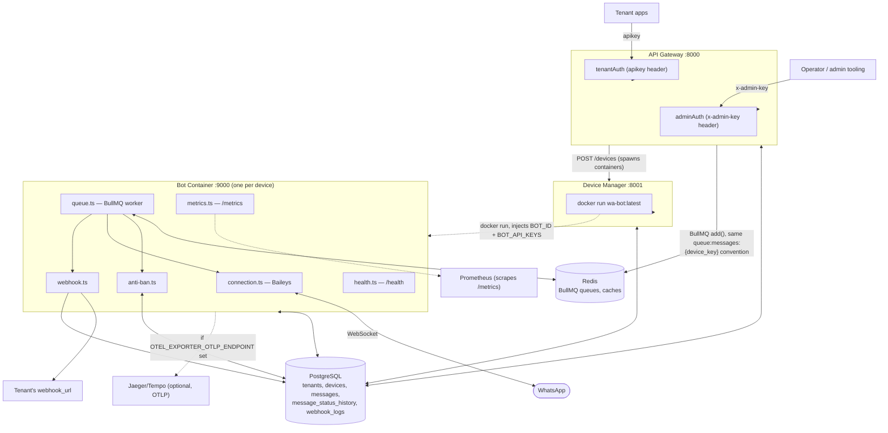

# Architecture

## Personal single-host deployment

`docker/docker-compose.personal.yml` provides one API Gateway, Device Manager,
Next.js standalone dashboard, PostgreSQL and Redis on a dedicated bridge network.
The optional nginx profile exposes the dashboard and tenant API on a single
origin with Certbot TLS. The dashboard also proxies `/api/v1` directly when nginx
is disabled. Both patterns require an explicit single trusted proxy hop at the API.

Compose waits for database readiness and successful compiled migrations before
starting applications. Device Manager builds no images at runtime: the start
script prebuilds the bot image, then the manager creates labelled per-device
containers with restart policies, bounded logs and host-owned persistent sessions.
Redis uses AOF and `noeviction` to preserve BullMQ jobs. Personal ports, volume
names, network, env file and sessions are separate from development resources.
See [personal setup](PERSONAL_SETUP.md) for start/stop, backup and TLS workflows.

## System diagram



- **API Gateway** (`src/api-gateway`, Codex) — the only thing tenants call
  directly. `/api/v1/*` authenticated by a tenant's `api_key`, `/admin/*` by
  `ADMIN_API_KEY`. Enqueues messages directly onto the **same** BullMQ queue
  (`new Queue(deviceKey, { prefix: 'queue:messages' })`) that bot-container's
  worker consumes — this link was a documented gap earlier in development;
  it's real now, verified end-to-end by `scripts/integration-test.ts`.
- **Device Manager** (`src/device-manager`, Codex) — `POST /devices`
  provisions a `devices` row, then shells out to `docker run` with the
  `wa-bot:latest` image (built from `docker/bot-container.Dockerfile`),
  injecting `BOT_ID=<device_key>` and `BOT_API_KEYS=<admin key>`.
- **Bot Container** (`src/bot-container`, Claude) — one process per
  WhatsApp device. See below.

## Bot container internals

```
index.ts (entrypoint)
 ├─ tracing.ts      OpenTelemetry SDK — imported FIRST, before anything else
 │                  (auto-instrumentation only sees modules required after it)
 ├─ connection.ts   makeWASocket, reconnect backoff [5,10,20,40,60]s,
 │                  stops reconnecting on DisconnectReason.loggedOut
 ├─ session.ts      per-device auth state (useMultiFileAuthState)
 ├─ queue.ts        BullMQ worker: pop job → anti-ban check → typing sim
 │                  → sock.sendMessage (traced) → update `messages` → webhook
 │                  + a separate `messages.update` listener that turns
 │                  Baileys delivery/read acks into status updates + webhooks
 ├─ anti-ban.ts     health-score-based daily cap, per-minute
 │                  rate limit, 8am–10pm WIB sending window, human-like delay
 ├─ health-score.ts pure scoring function + DB-backed calculation/cache
 ├─ content-filter.ts spam/caps/similarity/spintax/personalization checks
 ├─ webhook.ts      HMAC-signed delivery to tenant webhook_url, 3 retries (traced)
 ├─ metrics.ts      prom-client registry: sent/failed/duration/active
 │                  connections/anti-ban denials/webhook outcomes
 ├─ health.ts       dependency-aware health report (db/redis/whatsapp)
 └─ api.ts          /health /ready /metrics /status /send
                     (API-key gated except /health /ready /metrics)
```

Design decisions worth knowing:

- **BullMQ job payload is just `{ messageId }`.** The `messages` row is the
  source of truth; the worker re-reads it on every attempt instead of
  carrying a stale copy in the job. Queue names can't contain `:` (a BullMQ
  constraint), so the `queue:messages:{device_key}` convention from the spec
  is expressed via the `prefix` option, not the literal queue name — both
  api-gateway and bot-container independently arrived at the identical
  convention.
- **Anti-ban denials are split into transient vs. permanent.** Rate/cap/time
  -window denials re-queue the job with a delay instead of failing
  it; `device_not_found` and `content_rejected` throw `UnrecoverableError`
  and fail immediately — retrying the same rejected content wouldn't help.
- **A device with zero message history does not get force-paused.** The raw
  health-score formula is purely additive from 0, so a brand-new device would
  otherwise score 0 (below the pause threshold) on day one. Below 10 sent
  messages, the health cap falls back to the lowest non-pause tier (5/day)
  instead of pausing — health-based caps apply while the delivery history is limited.
- **Two independent pause mechanisms both gate sending.** An admin calling
  `POST /api/v1/devices/:key/pause` only sets `devices.status`; anti-ban's
  own automatic health-score pause sets `status` *and* `paused_until`.
  `canSendMessage()` checks both — see `docs/RUNBOOK.md` for the incident
  this fixed.
- **Delivery/read status is decoupled from the send job.** The worker marks
  a message `sent` and returns; a separate `messages.update` listener on the
  socket watches for delivery/read acks (matched by `whatsapp_message_id`)
  and updates the row + fires the webhook independently. A job doesn't block
  a worker slot waiting for a receipt that might never arrive.
- **`getDeviceByKeyCached`** (Redis, 3s TTL) exists only for the read-only
  `GET /status` endpoint. The anti-ban decision path (`canSendMessage`,
  `calculateHealthScore`) always reads the live row — caching data that
  gates whether a message is allowed to send is not worth the staleness risk.
- **`process.env.TZ = 'UTC'`** is set at the top of
  `shared/database/connection.ts` — every timestamp column is `timestamp
  without time zone`, and node-postgres reads/writes those using the host's
  local timezone. On a non-UTC host this silently breaks every JS-side
  time-window comparison (see `docs/RUNBOOK.md`). This line is
  load-bearing; do not remove it without understanding why it's there.

## Observability

- **Metrics**: each bot-container exposes Prometheus-format metrics at
  `GET /metrics` (no auth — same convention as `/health`/`/ready`, protect
  at the network layer). Custom metrics: `wa_bot_messages_sent_total`,
  `wa_bot_messages_failed_total{reason}`, `wa_bot_message_duration_seconds`
  (via `message.send` span timing — see tracing), `wa_bot_active_connections`,
  `wa_bot_anti_ban_denials_total{reason}`, `wa_bot_webhook_dispatch_total{event,outcome}`,
  `wa_bot_queue_job_duration_seconds`, plus prom-client's default Node
  process metrics (`wa_bot_process_*`, `wa_bot_nodejs_*`).
- **Tracing**: OpenTelemetry, auto-instrumenting `http`/`express`/`pg`/`ioredis`,
  plus explicit spans around `message.send` and `webhook.dispatch`
  (`tracing.ts`'s `withSpan` helper — records exceptions and sets span
  status on failure). Exports via OTLP/HTTP; set
  `OTEL_EXPORTER_OTLP_ENDPOINT=http://<collector>:4318` to actually ship
  spans to Jaeger/Tempo/etc. Without it, the exporter just logs failed send
  attempts to itself — harmless, but traces go nowhere. Disable entirely
  with `OTEL_TRACING_ENABLED=false`.
- **Health**: `GET /health` distinguishes `healthy` (all three dependencies
  fine) from `degraded` (WhatsApp not connected — normal during
  QR-pending/reconnect, still `200`) from `unhealthy` (Postgres or Redis
  unreachable — `503`). The Dockerfile's `HEALTHCHECK` and Kubernetes
  liveness probes should point at `/health`; use `/ready` (WhatsApp `online`
  specifically) for readiness/traffic-routing decisions.

## Device Manager orchestration

Device Manager keeps one HTTP contract for both deployment targets. In local
development, `ORCHESTRATOR=docker` (or the default `auto` mode outside a
cluster) provisions bot containers through the Docker CLI. In production,
`ORCHESTRATOR=kubernetes` uses the pod's in-cluster ServiceAccount credentials
and the official Kubernetes client.

Each device maps to one independently scalable StatefulSet named
`bot-<device-key>`. Its WhatsApp session is held by a retained 1Gi
ReadWriteOnce PVC, while database, Redis, and API credentials are injected
from `wa-gateway-secrets`. Creation is idempotent: an existing StatefulSet is
replaced with its current `resourceVersion`; pause/resume maps to zero/one
replica. The namespaced Role in `k8s/device-manager/deployment.yaml` contains
the StatefulSet and Pod permissions used by the controller.

`GET /health` checks both PostgreSQL and the active orchestration backend, so
Kubernetes RBAC or API connectivity failures make the controller unready.
The public API Gateway still calls the internal `POST /devices` endpoint and
does not need deployment-mode-specific logic.

## Known gaps / not yet wired

- **`device.status_changed` webhook** is now dispatched on online/offline/banned/logged_out/error
  and stored in `device_events`; there is still no automatic failover to a standby number.
- **Media captions.** The `messages` table has no `caption` column; media
  messages send with `content` as the URL and no caption.
- **Tenant self-service.** No `GET/PATCH /api/v1/tenant` — a tenant can't
  fetch or update their own name/email/webhook_url/quota, or regenerate
  their API key, through the API. `POST /admin/device/create` (the only way
  to provision a device) requires the *operator's* admin key, not something
  a tenant-facing dashboard should ever hold — a tenant-scoped
  `POST /api/v1/devices` that proxies to Device Manager server-side (the
  admin route's own pattern, just re-scoped) is the natural fix. Tracked in
  `dashboard/README.md`.
- **API Gateway's own `/health`** is a bare `{status:"ok"}` — it doesn't
  check its Postgres/Redis dependencies the way bot-container's does. A DB
  outage surfaces as request failures, not a red health check. See
  `docs/RUNBOOK.md`.
- **Docker image build unverified.** `docker/bot-container.Dockerfile` has
  never been run through a real `docker build` in this development
  environment (no Docker socket access in the sandbox this was built in).
  `tsc`/`npm test`/`npm run build` all pass and the Dockerfile was reviewed
  by hand, but verify with a real build before depending on it.
